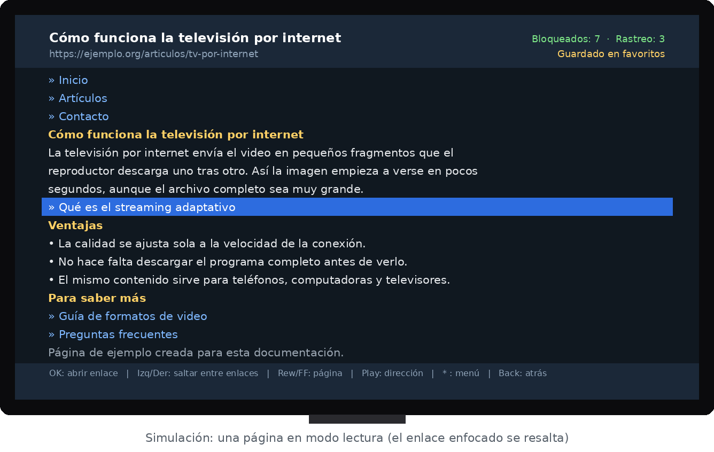
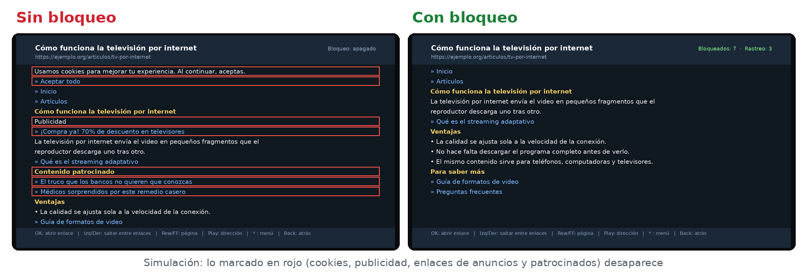
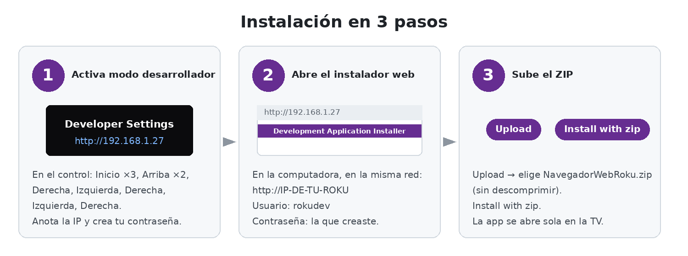
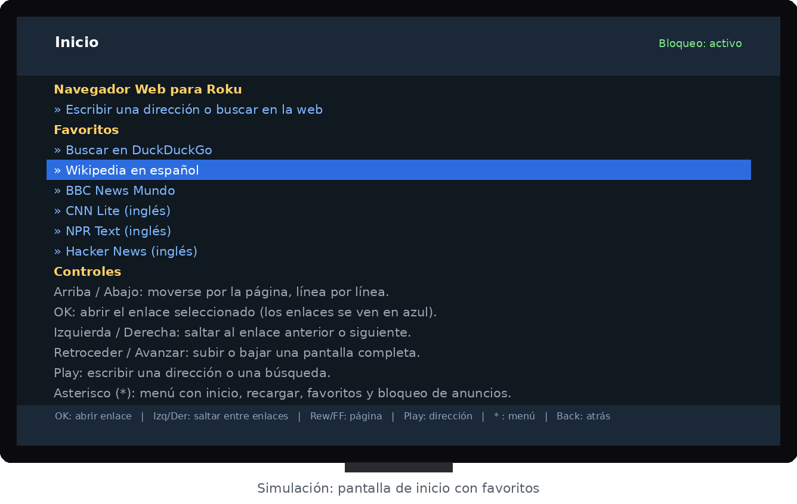
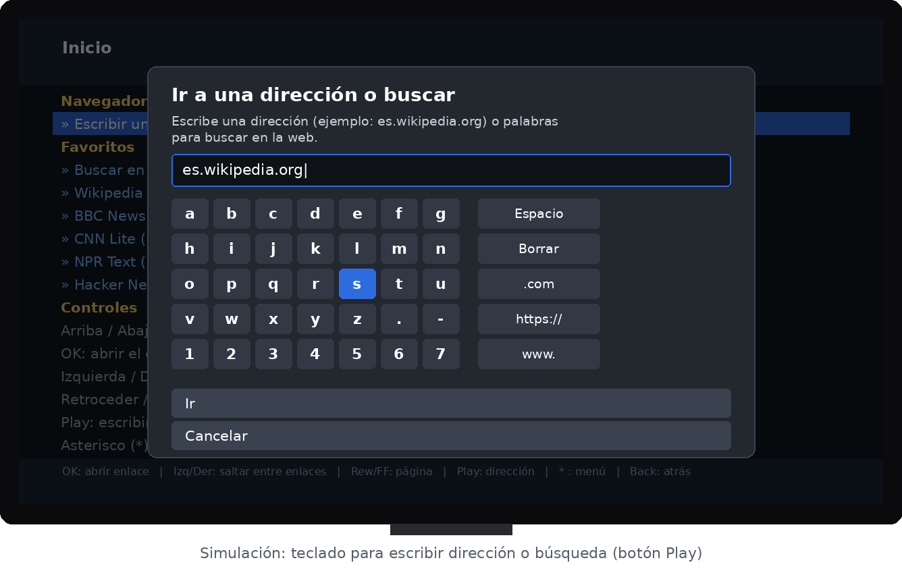
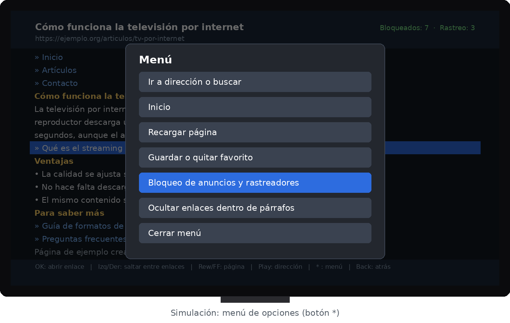
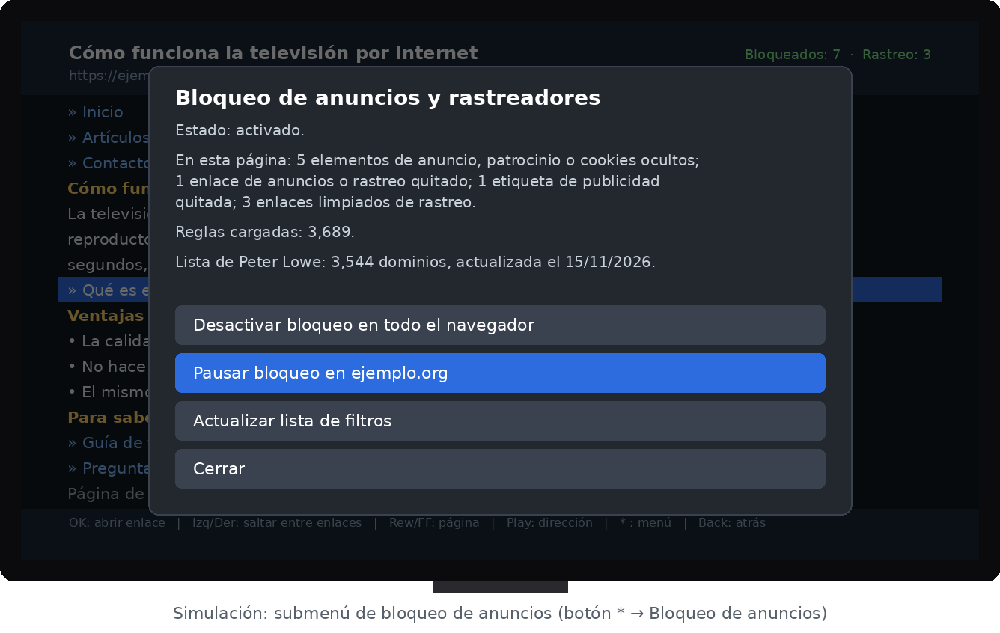

<p align="center">
  
</p>

<p align="center">
  <a href="https://github.com/web-gdl/RokuBrowser/raw/main/download/NavegadorWebRoku.zip"><b>⬇️ Descargar NavegadorWebRoku.zip</b></a>
  &nbsp;·&nbsp;
  <a href="docs/INSTALACION.md">Instalación</a>
  &nbsp;·&nbsp;
  <a href="docs/USO.md">Manual de uso</a>
  &nbsp;·&nbsp;
  <a href="docs/BLOQUEO.md">Bloqueo de anuncios</a>
  &nbsp;·&nbsp;
  <a href="docs/ARQUITECTURA.md">Arquitectura</a>
  &nbsp;·&nbsp;
  <a href="docs/DESARROLLO.md">Desarrollo</a>
</p>

# RokuBrowser

**RokuBrowser** es un navegador web para televisores y reproductores **Roku**, escrito en BrightScript y SceneGraph. Se instala por *sideload* desde el modo desarrollador, sin pasar por la tienda de canales.

Roku no incluye un motor HTML ni JavaScript, así que no es posible un navegador como Chrome. RokuBrowser trabaja en **modo lectura**: descarga la página, extrae los títulos, el texto y los enlaces, y los muestra en una lista que se recorre con el control remoto.

<p align="center">
  
</p>

> Las pantallas de esta documentación son **simulaciones** dibujadas con las mismas medidas, colores y textos que usa la app (ver [`tools/make_images.py`](tools/make_images.py)). No son capturas de un televisor.

## Características

- 🛡️ **Bloqueo de anuncios, rastreadores y patrocinios**, inspirado en uBlock Origin, AdBlock y Ghostery: oculta bloques de anuncios y avisos de cookies, quita enlaces patrocinados y limpia los enlaces de rastreo. Activado de fábrica, con contador en pantalla y opción de pausarlo por sitio. [Más detalles](docs/BLOQUEO.md).
- 🌐 Abre cualquier dirección `http://` o `https://`.
- 🔎 Busca en la web desde el mismo cuadro (DuckDuckGo en su versión HTML).
- 🔗 Los enlaces se ven en azul; **Izquierda/Derecha** salta directo al anterior o al siguiente.
- ⭐ Favoritos que se guardan en el propio Roku y siguen ahí después de apagarlo.
- ↩️ Historial: **Back** regresa a la página anterior (hasta 30 páginas).
- 📄 Avance por pantallas con **Retroceder / Avanzar**.
- 🧹 Quita scripts, estilos y comentarios; convierte entidades HTML (`&aacute;` → á) y URLs relativas.
- 🇲🇽 Interfaz en español.

## Bloqueo de anuncios

<p align="center">
  
</p>

El navegador no ejecuta JavaScript ni carga imágenes, así que los scripts de anuncios nunca corren en tu televisor. Además, el bloqueador limpia lo que sí llega en el HTML:

| Capa | Qué quita |
|---|---|
| Elementos | Bloques de anuncios, contenido patrocinado (Taboola, Outbrain…) y avisos de cookies |
| Enlaces | Enlaces a redes de anuncios y de rastreo, y resultados pagados del buscador |
| Navegación | Abrir una dirección de esas redes muestra **Página bloqueada** |
| Rastreo | Parámetros `utm_*`, `fbclid`, `gclid` y redirectores de Google y Facebook |
| Etiquetas | Textos como "Publicidad" o "Contenido patrocinado" |

Usa una lista integrada de unas 150 reglas, compatible con la sintaxis básica de Adblock Plus, y puede descargar la lista de Peter Lowe (unos 3,500 dominios) desde el menú. SponsorBlock salta segmentos patrocinados *dentro de videos*; como este navegador no reproduce video, lo equivalente aquí es ocultar el contenido patrocinado de las páginas. Detalles, sintaxis y comparación con cada extensión en [docs/BLOQUEO.md](docs/BLOQUEO.md).

## Qué funciona y qué no

| Funciona bien | No funciona |
|---|---|
| Wikipedia (versión móvil) | Imágenes y video |
| Sitios de noticias y blogs | Sitios que dependen de JavaScript (YouTube, Facebook, apps web) |
| Versiones "lite" o de solo texto | Formularios e inicios de sesión |
| Documentación y páginas de texto | Páginas con codificación distinta de UTF-8 (algunos acentos pueden verse mal) |

Si una página no tiene texto legible, el navegador lo avisa y ofrece volver al inicio.

## Instalación rápida

<p align="center">
  
</p>

1. **Activa el modo desarrollador** en tu Roku: en el control pulsa `Inicio ×3, Arriba ×2, Derecha, Izquierda, Derecha, Izquierda, Derecha`. Anota la dirección IP que aparece y crea una contraseña.
2. **Descarga** [`NavegadorWebRoku.zip`](https://github.com/web-gdl/RokuBrowser/raw/main/download/NavegadorWebRoku.zip). No lo descomprimas.
3. En una computadora conectada a la misma red, abre `http://IP-DE-TU-ROKU`, entra con el usuario `rokudev` y tu contraseña, pulsa **Upload**, elige el ZIP y luego **Install with zip**.

Guía completa, con solución de problemas: [docs/INSTALACION.md](docs/INSTALACION.md).

## Controles

<p align="center">
  
</p>

| Botón | Acción |
|---|---|
| Arriba / Abajo | Moverse por la página, línea por línea |
| OK | Abrir el enlace seleccionado |
| Izquierda / Derecha | Saltar al enlace anterior o siguiente |
| Retroceder / Avanzar | Subir o bajar una pantalla |
| Play | Escribir una dirección o una búsqueda |
| Asterisco (`*`) | Menú: inicio, recargar, favoritos, bloqueo de anuncios, mostrar u ocultar enlaces de párrafos |
| Repetir (`↺`) | Recargar la página |
| Back | Página anterior; en la pantalla de inicio sale de la app |

Más detalles en el [manual de uso](docs/USO.md).

## Pantallas

| Inicio | Teclado |
|---|---|
|  |  |
| **Menú** | **Bloqueo de anuncios** |
|  |  |

## Estructura del proyecto

```text
RokuBrowser/
├── app/                      Código del canal (lo que va dentro del ZIP)
│   ├── manifest
│   ├── source/main.brs
│   ├── components/
│   │   ├── MainScene.xml/.brs    Interfaz y control remoto
│   │   ├── BrowserTask.xml/.brs  Red, inicio y favoritos (hilo aparte)
│   │   ├── HtmlParser.brs        HTML → líneas de texto y enlaces
│   │   ├── AdFilter.brs          Bloqueo de anuncios, rastreo y patrocinios
│   │   └── LineItem.xml/.brs     Una fila de la lista
│   ├── filters/filtros.txt   Lista de filtros integrada (sintaxis Adblock Plus)
│   └── images/               Icono, splash y foco
├── download/                 NavegadorWebRoku.zip listo para instalar
├── docs/                     Documentación e imágenes
├── tools/
│   ├── build.sh              Genera el ZIP
│   ├── make_images.py        Genera iconos e imágenes de la documentación
│   └── test/                 Pruebas del analizador y del bloqueo
├── .github/workflows/        Publica la release al subir una etiqueta v*
├── bsconfig.json             Configuración de BrighterScript (validación)
└── package.json
```

## Compilar desde el código

```bash
npm install          # instala BrighterScript y el intérprete brs
npm run lint         # valida todo el código BrightScript
npm test             # 32 pruebas del analizador HTML y del bloqueo de anuncios
npm run build        # crea download/NavegadorWebRoku.zip
```

Guía para desarrolladores: [docs/DESARROLLO.md](docs/DESARROLLO.md).

## Compatibilidad

Pensado para la interfaz HD (1280×720), que Roku escala a cualquier televisor. Probado en el desarrollo con el compilador BrighterScript y con el intérprete `brs`; las pruebas en dispositivos reales se van anotando en el [CHANGELOG](CHANGELOG.md). Si lo pruebas en tu Roku, abre un *issue* con el modelo y el resultado.

## Licencia

[MIT](LICENSE). Roku es una marca registrada de Roku, Inc.; este proyecto no está afiliado ni respaldado por Roku. uBlock Origin, AdBlock, Ghostery y SponsorBlock se mencionan solo como referencia; RokuBrowser no está afiliado a esos proyectos ni usa su código.
