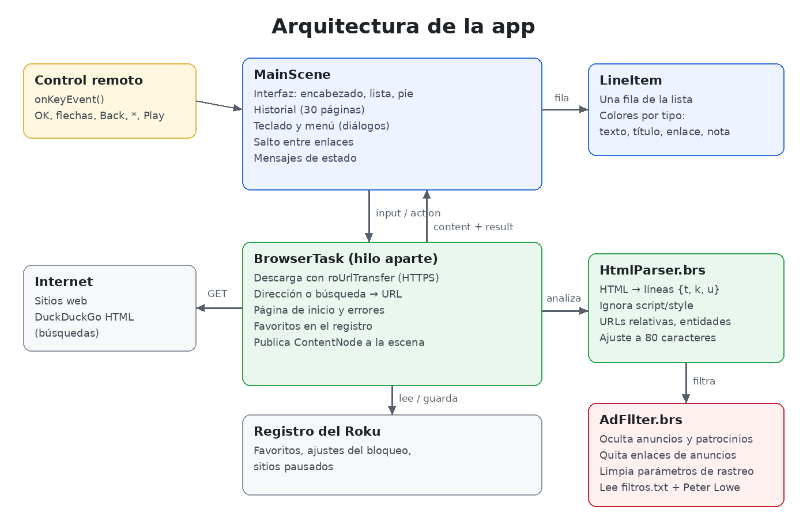

# Arquitectura

[← Volver al inicio](../README.md)

RokuBrowser es un canal SceneGraph. La interfaz vive en el hilo de render (`MainScene`) y todo el trabajo lento (red, análisis del HTML, registro) ocurre en un `Task` aparte (`BrowserTask`), para que la pantalla no se congele mientras carga.

## Componentes

### `source/main.brs`
Punto de entrada. Crea la pantalla `roSGScreen`, la escena `MainScene` y espera a que se cierre.

### `components/MainScene.xml` / `.brs`
La interfaz y el control remoto.

- **Diseño** (1280×720): encabezado con título y dirección, una `MarkupList` de 16 filas de 34 px y un pie con los controles.
- **Navegación**: `navigate(target, push)` crea un `BrowserTask` con `action = "load"`. Cuando el task termina, la página se convierte en la actual y, si `push` es verdadero, la anterior pasa al historial.
- **Historial**: hasta 30 entradas `{ url, title, content, links, index }`. Solo las 6 más recientes conservan su `ContentNode`; las demás guardan la dirección y la posición, y se descargan otra vez al volver.
- **Diálogos**: `StandardKeyboardDialog` para la dirección y `StandardMessageDialog` para el menú. Mientras hay un diálogo abierto, `onKeyEvent` no procesa teclas.
- **Saltos**: `links` es la lista de índices de filas que son enlaces; Izquierda/Derecha buscan el anterior o el siguiente respecto a la fila enfocada.

### `components/BrowserTask.xml` / `.brs`
Hilo de trabajo. Campos:

| Campo | Dirección | Uso |
|---|---|---|
| `action` | entrada | `"load"` o `"bookmark"` |
| `input` | entrada | Dirección, búsqueda o página interna (`app:home`) |
| `pageTitle` | entrada | Título al guardar un favorito |
| `inlineLinks` | entrada | Mostrar enlaces dentro de párrafos |
| `content` | salida | `ContentNode` con una fila por hijo |
| `result` | salida | `{ url, title, links }` o `{ message }`. Se asigna al final: la escena lo observa |

Además de `load` y `bookmark`, `action` puede ser `adblock` (encender o apagar el bloqueo), `site` (pausar o reactivar el bloqueo en el sitio que llega en `input`) o `filters` (descargar la lista de Peter Lowe).

Pasos de `loadPage`:

1. `toUrl()` decide si el texto es una dirección o una búsqueda.
2. Lee los ajustes del bloqueo; si está activo para ese sitio, `setupFilters()` carga `pkg:/filters/filtros.txt` y la lista descargada.
3. Si la dirección es de una red de anuncios o rastreo, publica **Página bloqueada** (salvo que llegue con el prefijo `app:unblock:`).
4. Rechaza extensiones de imagen, video y archivos antes de descargar.
5. `httpGet()` descarga con `roUrlTransfer` (certificados de Roku, cookies, gzip, cabeceras DNT y GPC, 25 s de espera).
6. Según el `Content-Type`, usa `parseHtml()` o `plainPage()`. Si el filtro dejó la página casi vacía, la analiza otra vez sin ocultar elementos.
7. `publish()` convierte las líneas en `ContentNode` y entrega el resultado con las estadísticas del bloqueo.

En el registro del Roku (`roRegistrySection "navegador"`) se guardan como JSON los favoritos (`bookmarks`), el estado del bloqueo (`adblock`), los sitios pausados (`allowlist`) y los datos de la lista descargada (`filtersInfo`). La lista misma va en `cachefs:/filtros-remotos.txt`, porque el registro solo admite 16 KB por canal.

### `components/HtmlParser.brs`
Convierte HTML en líneas `{ t: texto, k: tipo, u: url }`, donde el tipo es `t` (texto), `h` (título), `l` (enlace) o `m` (nota).

No es un analizador DOM completo; recorre el HTML una sola vez partiéndolo en `<`:

- Ignora el contenido de `script`, `style`, `svg`, `noscript`, `template`, `iframe`, etc., y los comentarios.
- Las etiquetas de bloque (`p`, `div`, `li`, `h1`…`h6`, `tr`…) cierran el párrafo actual.
- Cada párrafo produce primero su texto (ajustado a 80 caracteres por línea) y debajo sus enlaces. Si el párrafo es casi solo enlaces (un menú), no se repite el texto.
- Un enlace que envuelve varios bloques (una "tarjeta") se mantiene como un solo enlace.
- Resuelve URLs relativas (`/ruta`, `../ruta`, `?consulta`, `//host`), aplica `<base href>`, descarta `javascript:`, `mailto:` y anclas `#`, y extrae el destino real de los enlaces de DuckDuckGo (`uddg=`).
- Decodifica entidades con nombre comunes en español y las numéricas (`&#233;`, `&#xE9;`).

### `components/AdFilter.brs`
El bloqueador. `setupFilters(activo, texto)` prepara las expresiones regulares y carga las reglas en tablas asociativas (dominios, rutas, excepciones, clases e ids), así que cada consulta es una búsqueda directa.

El analizador lo usa en cuatro puntos:

- **Al abrir una etiqueta** (`isAdElement`): revisa `class`, `id`, `data-ad*` y `aria-label`. Si es un anuncio, `startHide` empieza a ocultar y `hidePiece` cuenta aperturas y cierres de esa etiqueta hasta encontrar el cierre correspondiente. Los `<script>` dentro del anuncio se saltan para que un `"<div"` en su texto no altere la cuenta, `<li>` y `
` sin cerrar terminan con el siguiente hermano, y si en 5,000 etiquetas no aparece el cierre, deja de ocultar.
- **Al cerrar un enlace** (`isBlockedUrl`, `isAdLabel`): si apunta a un dominio bloqueado o su texto es "Publicidad", quita el enlace y también su texto del párrafo (`bufStart`).
- **Al cerrar un párrafo**: quita el bloque si todo su texto es una etiqueta de publicidad.
- **Al resolver una dirección** (`cleanUrl`): desenvuelve redirectores y quita parámetros de rastreo.

Las estadísticas quedan en `m.stats` (`hidden`, `links`, `labels`, `trackers`).

### `components/LineItem.xml` / `.brs`
El componente de cada fila de la `MarkupList`. Lee el tipo desde `shortDescriptionLine1` y elige fuente y color.

## Decisiones de diseño

- **Modo lectura en vez de motor web.** Roku no ofrece un componente de navegador. Renderizar HTML/CSS completo en BrightScript sería enorme y lento; el texto con enlaces cubre bien la lectura de noticias, Wikipedia y documentación.
- **Una lista de filas.** La `MarkupList` solo crea las filas visibles, así que una página de 1,500 líneas no satura la memoria, y el enfoque del control remoto funciona sin código extra.
- **El campo `result` se asigna al final.** Así la escena nunca recibe un `result` sin su `content`.
- **DuckDuckGo HTML** para las búsquedas porque funciona sin JavaScript y sin clave de API.
- **Bloqueo sobre el HTML, no sobre la red.** Como el navegador solo descarga la página que abres, no hay peticiones a servidores de anuncios que interceptar. El filtro se aplica al convertir el HTML en líneas, en el mismo recorrido, y en las pruebas agrega alrededor de un 20 % al tiempo de análisis.
- **Sin EasyList completa.** Tiene decenas de miles de reglas y varios megabytes; en un Roku de gama baja tardaría demasiado en cargarse con cada página. La detección por palabras en clases e ids cubre la mayoría de sus reglas genéricas con mucho menos costo.
