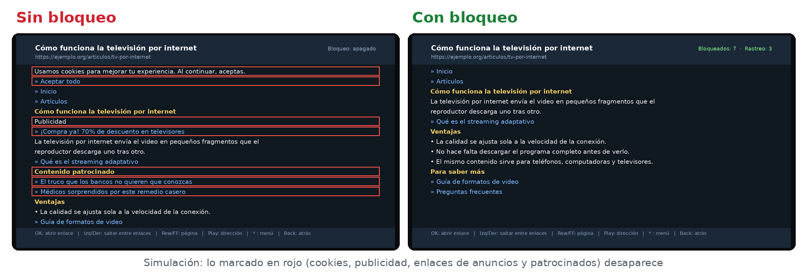
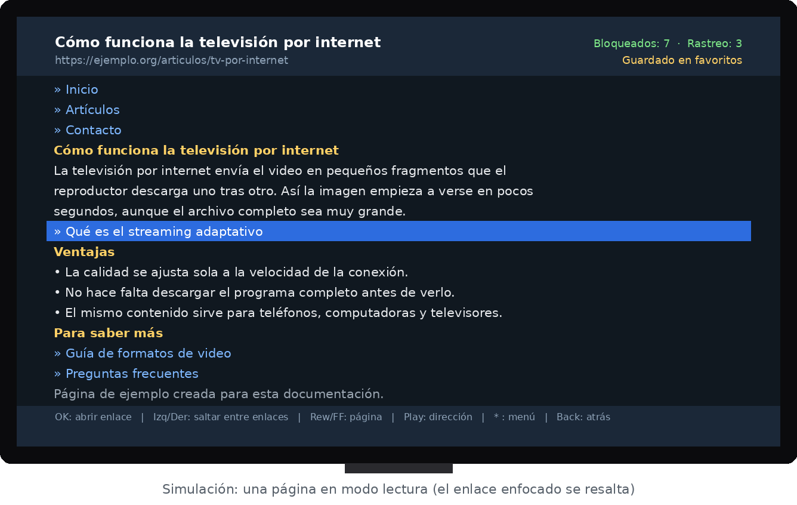
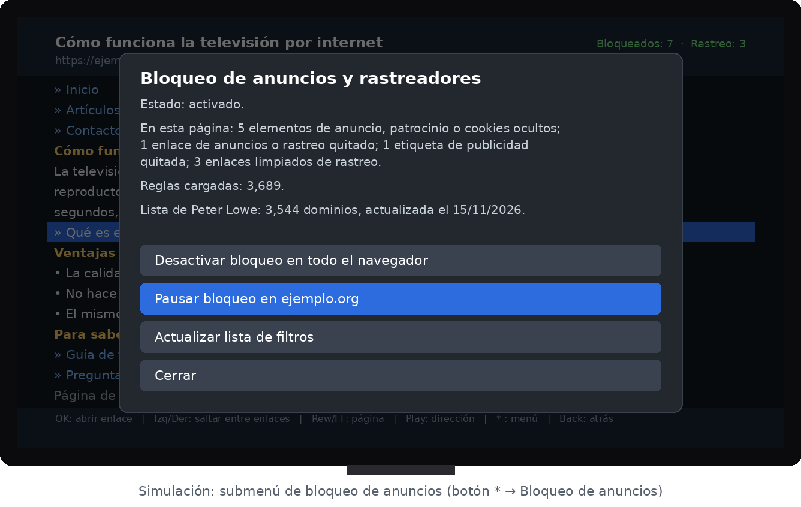

# Bloqueo de anuncios, rastreadores y patrocinios

[← Volver al inicio](../README.md)



Desde la versión 1.1, RokuBrowser incluye un bloqueador inspirado en extensiones como uBlock Origin, AdBlock y Ghostery. Viene **activado** y no requiere configuración.

## Cómo funciona

RokuBrowser no ejecuta JavaScript ni carga imágenes, así que los scripts de anuncios y de rastreo **nunca llegan a ejecutarse** en el televisor: el navegador solo descarga el HTML de la página que abres. Lo que sí aparece en una página, aunque sea en texto, son los bloques de anuncios, los enlaces patrocinados y los enlaces con rastreo. El bloqueador actúa sobre eso, en cinco capas:

| Capa | Qué hace | Ejemplos |
|---|---|---|
| **Elementos** | Oculta bloques cuya clase, id o atributos indican anuncio, patrocinio o aviso de cookies | `class="ad-slot"`, `adsbygoogle`, `id="taboola-below-article"`, `data-ad-slot`, `aria-label="Publicidad"`, `class="sponsored"`, banners de OneTrust o Cookiebot |
| **Enlaces** | Quita los enlaces a redes de anuncios y de rastreo, junto con su texto | `doubleclick.net`, `taboola.com`, `outbrain.com`, `bing.com/aclk`, resultados pagados de DuckDuckGo |
| **Navegación** | Si abres una dirección de esas redes, muestra **Página bloqueada** con la opción *Abrir de todos modos* | Escribir `doubleclick.net` en el teclado |
| **Rastreo en enlaces** | Limpia parámetros de seguimiento y desenvuelve redirectores | `?utm_source=…`, `fbclid`, `gclid`, `msclkid`; `google.com/url?q=…`, `l.facebook.com/l.php?u=…` |
| **Etiquetas** | Quita textos sueltos de publicidad | "Publicidad", "Anuncio", "Contenido patrocinado", "Advertisement", "Sponsored", "La nota continúa después de la publicidad" |

Además, cada petición envía las cabeceras `DNT: 1` (*Do Not Track*) y `Sec-GPC: 1` (*Global Privacy Control*), que piden al sitio no rastrearte. Respetarlas depende del sitio.

## Uso

### El contador



Arriba a la derecha se ve el estado, como el contador de la extensión uBlock:

| Texto | Significado |
|---|---|
| `Bloqueados: 7 · Rastreo: 3` | En esta página se quitaron 7 elementos o enlaces de anuncios y se limpiaron 3 enlaces de rastreo |
| `Bloqueo: activo` | Estás en el inicio o en una página interna |
| `Bloqueo: pausado en este sitio` | Pausaste el bloqueo en este sitio |
| `Bloqueo: apagado` | Desactivaste el bloqueo en todo el navegador |

### El submenú



Pulsa `*` y elige **Bloqueo de anuncios y rastreadores**. Muestra el detalle de lo bloqueado en la página y cuántas reglas hay cargadas, y tiene estas opciones:

| Opción | Qué hace |
|---|---|
| Desactivar / Activar bloqueo | Lo apaga o enciende en todo el navegador |
| Pausar / Reactivar bloqueo en *sitio* | Deja de filtrar solo ese sitio (equivale al botón de encendido de uBlock). Se recuerdan hasta 100 sitios |
| Actualizar lista de filtros | Descarga la lista de Peter Lowe (unos 3,500 dominios de anuncios y rastreo) |
| Cerrar | Cierra el submenú |

Los cambios se aplican al momento y la página se recarga.

## Listas de filtros

El navegador combina tres fuentes:

1. **Detección automática**: palabras en clases e ids como `ad`, `ads`, `advert`, `sponsored`, `promoted`, `publicidad`, `patrocinado`, `anuncio`, `taboola`, `outbrain`, `cookie`, `consent`, `gdpr`. Solo cuentan como palabra completa, separada por espacio, `-` o `_`: `ad-slot` o `result--ad` se ocultan, pero `header`, `download`, `badge` o `shadow` no.
2. **Lista integrada**: [`app/filters/filtros.txt`](../app/filters/filtros.txt), con unas 150 reglas para las principales redes de anuncios, rastreadores, plataformas de avisos de cookies y widgets de contenido patrocinado.
3. **Lista de Peter Lowe** (opcional): se descarga desde el submenú y queda en la memoria caché del Roku (`cachefs:`). Es la misma lista que uBlock Origin ofrece como *Peter Lowe's Ad and tracking server list*. Roku puede borrar esa caché si necesita espacio; en ese caso el submenú lo avisa y basta con actualizar otra vez.

### Sintaxis de `filtros.txt`

Es un subconjunto de la sintaxis de Adblock Plus y uBlock Origin:

```text
! comentario
||dominio.com^          bloquea enlaces y páginas de ese dominio y sus subdominios
||dominio.com/ruta      bloquea solo las direcciones que empiezan con esa ruta
@@||dominio.com^        excepción: nunca bloquear ese dominio
##.clase                oculta los elementos con esa clase
###id                   oculta el elemento con ese id
```

También acepta archivos *hosts* (`0.0.0.0 dominio.com`) y listas de un dominio por línea. Las reglas con opciones (`$third-party`, `$script`…) y los selectores CSS complejos se ignoran.

Para agregar reglas propias, edita `app/filters/filtros.txt`, ejecuta `npm run build` e instala el ZIP nuevo.

## Comparación con las extensiones

RokuBrowser no usa ni contiene código de estas extensiones; las menciona solo como referencia de lo que hace cada una.

| Extensión | Qué hace en un navegador de computadora | Qué hace RokuBrowser |
|---|---|---|
| uBlock Origin | Bloquea peticiones a servidores de anuncios con listas como EasyList y oculta elementos con filtros cosméticos | Lista compatible con la sintaxis básica, detección automática de clases e ids, y la lista de Peter Lowe. No admite EasyList completa (sería demasiado grande para el Roku), ni *scriptlets*, ni opciones `$` |
| AdBlock | Lo mismo, con listas propias y la opción de "anuncios aceptables" | Igual que arriba, sin "anuncios aceptables": todo lo que coincide se bloquea |
| Ghostery | Bloquea rastreadores, limpia direcciones y rechaza avisos de cookies | Quita enlaces a rastreadores, limpia `utm_*`, `fbclid`, `gclid` y otros, desenvuelve redirectores, oculta avisos de cookies y envía DNT y GPC |
| SponsorBlock | Salta los segmentos patrocinados *dentro de los videos* de YouTube, con marcas que envía la comunidad | **No aplica directamente**: RokuBrowser no reproduce video, y YouTube necesita JavaScript. Lo equivalente en una página de texto es ocultar los bloques y enlaces patrocinados ("Contenido patrocinado", Taboola, Outbrain, MGID…), que sí hace |

## Cuando el bloqueo oculta algo que no debía

- **Protección automática**: si después de filtrar casi no queda texto, el navegador vuelve a mostrar la página sin ocultar elementos y lo avisa con una nota gris arriba (los enlaces de anuncios y el rastreo se siguen filtrando).
- **Pausar en ese sitio**: `*` → Bloqueo de anuncios y rastreadores → *Pausar bloqueo en…*.
- **Página bloqueada por error**: usa *Abrir de todos modos* o agrega una excepción `@@||dominio^` a la lista.
- Si encuentras un caso así, abre un *issue* con la dirección de la página.

## Privacidad

- Todo ocurre dentro del televisor. El navegador no envía a ningún servidor qué páginas visitas ni qué se bloqueó.
- Los ajustes (encendido, sitios pausados) se guardan en el registro del Roku, junto con los favoritos.
- La única conexión que hace el bloqueador es la descarga de la lista de Peter Lowe, y solo cuando eliges *Actualizar lista de filtros*.

## Limitaciones

- Solo filtra lo que hay en el HTML. Los anuncios que un sitio inserta con JavaScript no aparecen en RokuBrowser de todos modos.
- La detección automática usa nombres comunes; un sitio con nombres de clase propios puede mostrar algún anuncio. Agrega una regla `##.clase` para ocultarlo.
- El texto que rodeaba un enlace de anuncio quitado puede quedar con alguna palabra suelta ("Visita … o …").
- Los números del contador se reinician en cada página.
