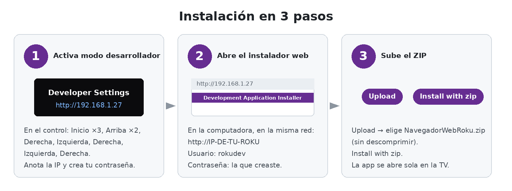

# Instalación

[← Volver al inicio](../README.md)



## Requisitos

- Un televisor o reproductor Roku conectado a internet.
- Una computadora (Windows, macOS o Linux) **en la misma red** que el Roku.
- El archivo [`NavegadorWebRoku.zip`](https://github.com/web-gdl/RokuBrowser/releases/latest/download/NavegadorWebRoku.zip).

## 1. Activar el modo desarrollador

1. Enciende el Roku y ve a la pantalla de inicio.
2. Con el control remoto pulsa, en este orden:
   `Inicio` `Inicio` `Inicio` `Arriba` `Arriba` `Derecha` `Izquierda` `Derecha` `Izquierda` `Derecha`
3. Aparece la pantalla **Developer Settings**. Anota la dirección que muestra, por ejemplo `http://192.168.1.27`.
4. Elige **Enable installer and restart**, acepta el acuerdo y crea una contraseña. **Guárdala**: la necesitarás cada vez que instales.
5. El Roku se reinicia.

Si ya activaste el modo desarrollador antes, puedes saltar este paso.

## 2. Abrir el instalador web

1. En la computadora, abre el navegador y escribe la dirección que anotaste (`http://192.168.1.27`).
2. Cuando pida usuario y contraseña, usa:
   - Usuario: `rokudev`
   - Contraseña: la que creaste en el paso 1
3. Se abre la página **Development Application Installer**.

> El navegador marcará la página como "No seguro" porque usa `http`. Es normal: es una página dentro de tu red local.

## 3. Instalar el ZIP

1. Descarga [`NavegadorWebRoku.zip`](https://github.com/web-gdl/RokuBrowser/releases/latest/download/NavegadorWebRoku.zip). **No lo descomprimas.**
2. Pulsa **Upload** y elige el archivo.
3. Pulsa **Install with zip**.
4. La página mostrará `Install Success` y la app se abrirá sola en la TV.

La app aparece en la pantalla de inicio del Roku como **Navegador Web**. Solo puede haber una app de desarrollo instalada a la vez: si subes otra, reemplaza a esta.

## Actualizar a una versión nueva

Repite el paso 3 con el ZIP nuevo. La página mostrará **Replace**; los favoritos guardados se conservan.

## Desinstalar

En el instalador web pulsa **Delete**. También se borra al desactivar el modo desarrollador.

## Solución de problemas

| Problema | Qué hacer |
|---|---|
| La página del instalador no abre | Comprueba que la computadora y el Roku estén en la misma red y que la IP sea la correcta (Configuración → Red → Acerca de). |
| Olvidé la contraseña | Repite la combinación del paso 1 y elige **Disable installer and restart**; después actívalo otra vez con una contraseña nueva. |
| `Install Failure: No manifest` | Subiste un ZIP que contiene una carpeta. Usa el ZIP de la página de descargas tal cual, o crea el tuyo con `npm run build`. |
| La app se cierra al abrirla | Abre la consola de depuración (ver abajo) y busca el error. Abre un *issue* con el texto. |
| Una página sale vacía | Ese sitio necesita JavaScript. Prueba con su versión móvil o "lite". |
| Los acentos se ven mal en un sitio | El sitio no usa UTF-8. Es una limitación conocida. |

## Consola de depuración

Roku muestra los mensajes y errores de la app por telnet en el puerto 8085:

```bash
telnet 192.168.1.27 8085
```

En Windows, si `telnet` no existe, actívalo en *Características de Windows* o usa [PuTTY](https://www.putty.org/) con conexión tipo *Telnet*.
