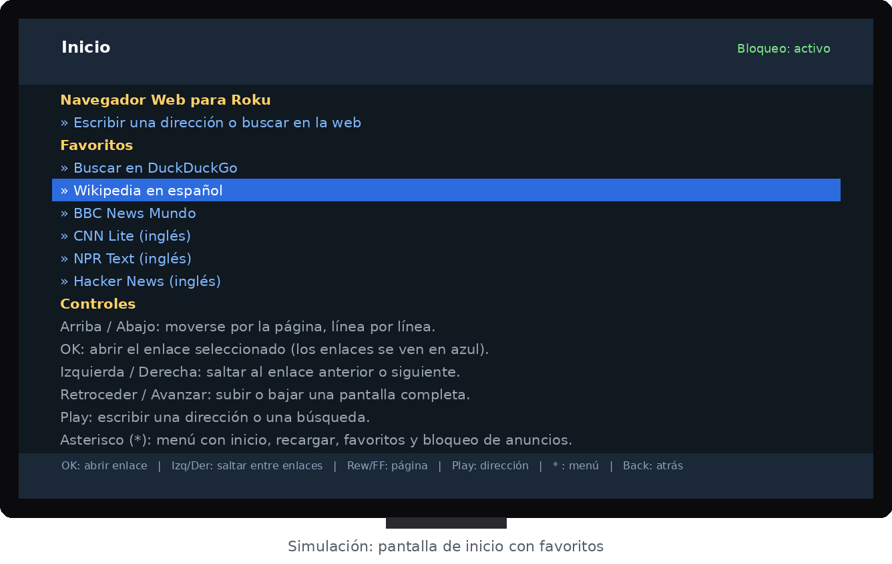
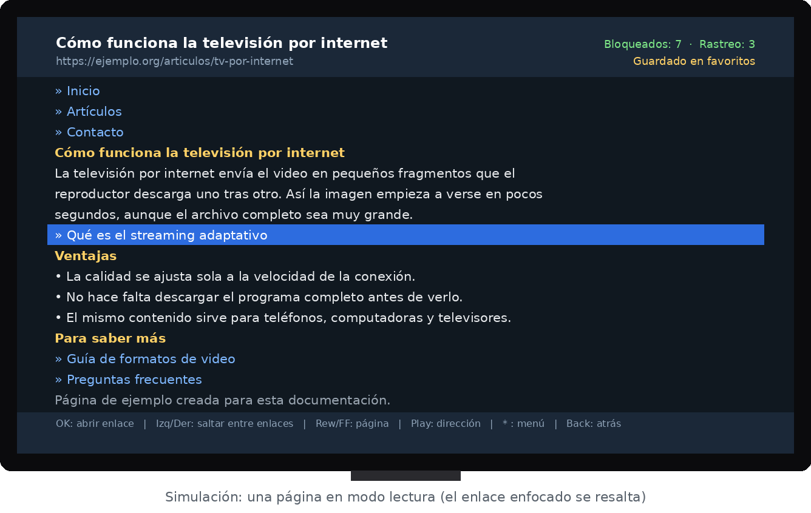
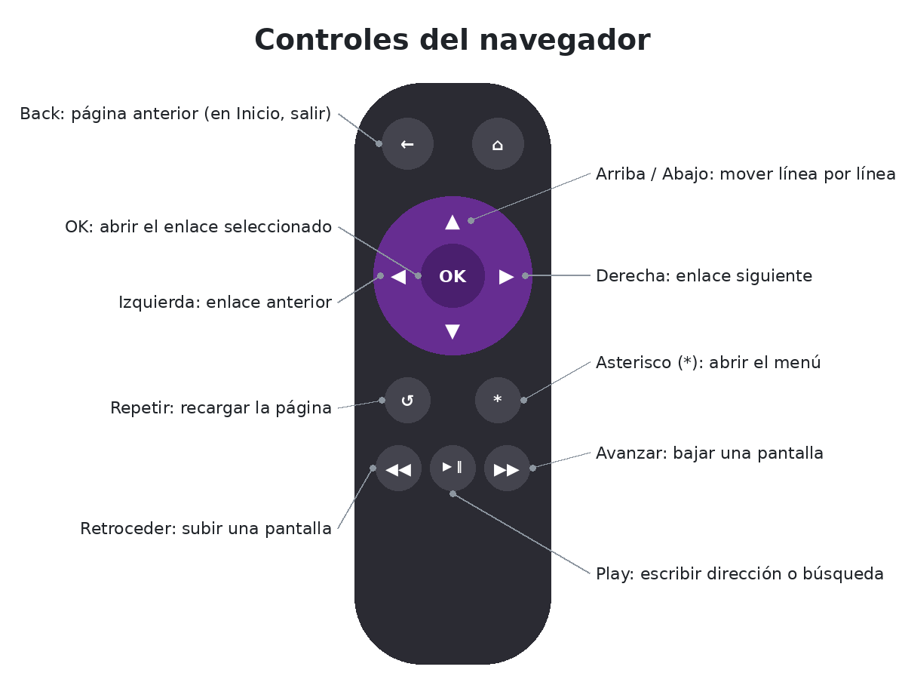
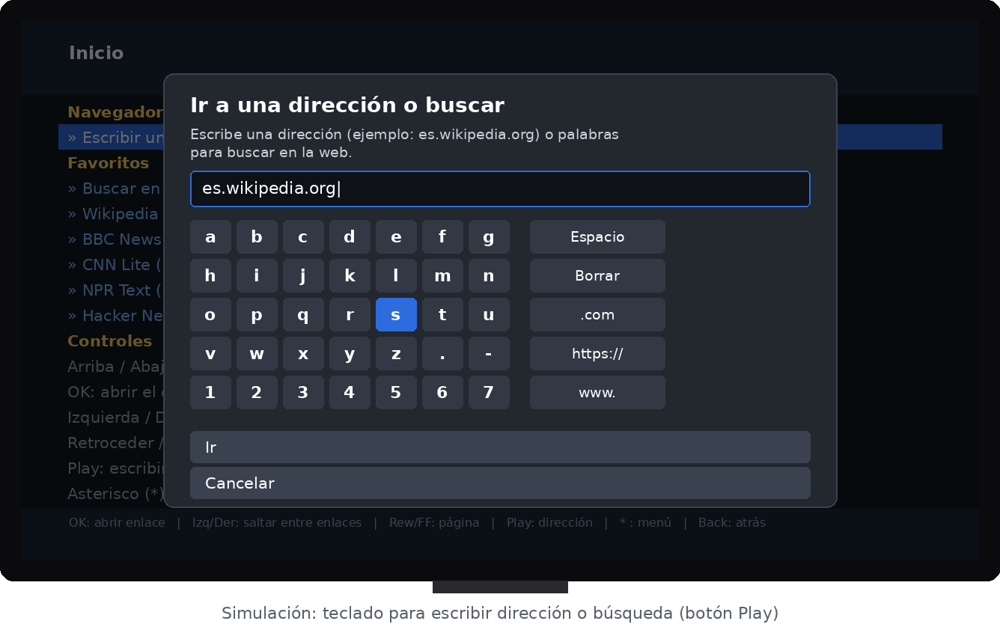
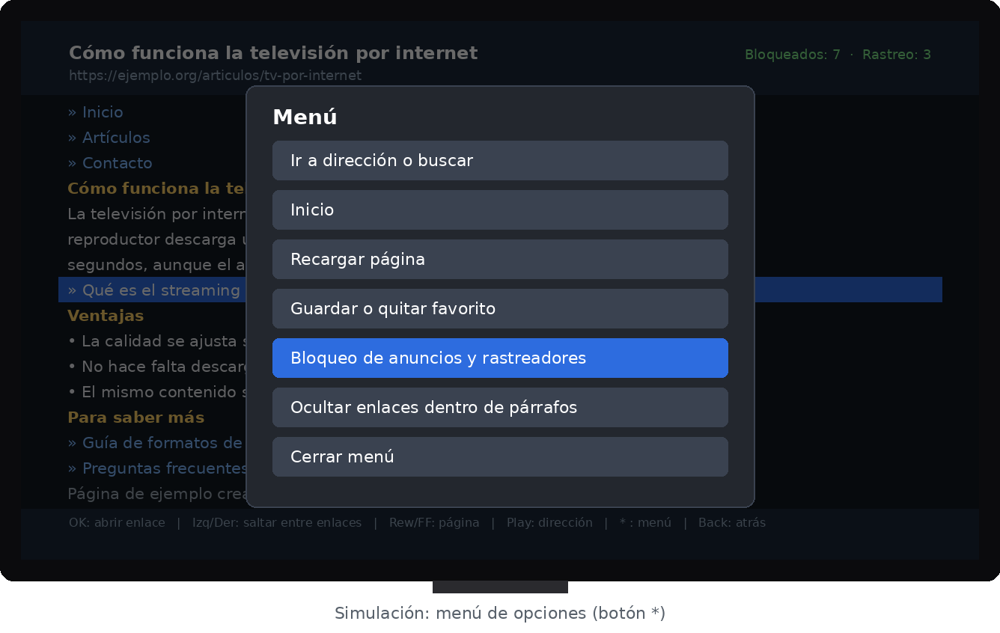
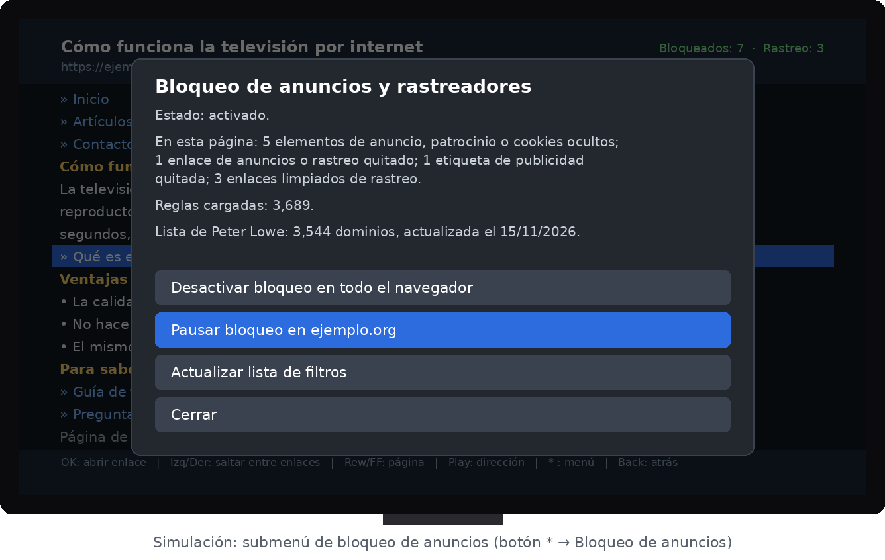

# Manual de uso

[← Volver al inicio](../README.md)

## Pantalla de inicio

Al abrir la app ves:

- **Escribir una dirección o buscar en la web**: abre el teclado.
- **Favoritos**: los sitios guardados. La primera vez trae seis de ejemplo (DuckDuckGo, Wikipedia en español, BBC News Mundo, CNN Lite, NPR Text y Hacker News).
- **Controles**: un resumen de los botones.

En esta pantalla, **Back** cierra la app.

## Leer una página

Cada página se muestra como una lista de líneas:

| Color | Significado |
|---|---|
| Amarillo, en negrita | Título o sección (`<h1>` a `<h6>`) |
| Blanco | Texto normal |
| Azul, con `»` | Enlace: pulsa **OK** para abrirlo |
| Gris | Notas del navegador (avisos, errores) |
| Fondo azul | La línea seleccionada |

Los enlaces que están dentro de un párrafo aparecen justo debajo de ese párrafo. Si prefieres una lectura más limpia, ocúltalos desde el menú (`*`) → **Ocultar enlaces dentro de párrafos**. Los menús de navegación del sitio se siguen mostrando.

El título de la página y su dirección aparecen arriba; abajo hay un recordatorio de los botones.

## Controles

| Botón | Acción |
|---|---|
| Arriba / Abajo | Moverse línea por línea |
| OK | Abrir el enlace seleccionado |
| Izquierda / Derecha | Saltar al enlace anterior o siguiente |
| Retroceder / Avanzar | Subir o bajar una pantalla (15 líneas) |
| Play | Escribir una dirección o una búsqueda |
| Asterisco (`*`) | Abrir el menú |
| Repetir (`↺`) | Recargar la página |
| Back | Volver a la página anterior. Mientras carga, cancela la carga |

## Escribir una dirección o buscar

Pulsa **Play** (o elige la opción en el inicio o en el menú). En el teclado:

- Si escribes algo **con punto y sin espacios**, se abre como dirección: `es.wikipedia.org` → `https://es.wikipedia.org`.
- Si escribes `http://` o `https://` al principio, se usa tal cual.
- **Cualquier otra cosa se busca en DuckDuckGo**: `clima guadalajara`, `receta pozole`. Los resultados llevan directo al sitio, sin pasar por el redirector de DuckDuckGo.

Pulsa **Ir** para abrir o **Cancelar** para cerrar.

## Menú

Con el botón `*`:

| Opción | Qué hace |
|---|---|
| Ir a dirección o buscar | Abre el teclado |
| Inicio | Vuelve a la pantalla de inicio (puedes regresar con Back) |
| Recargar página | Descarga la página otra vez y conserva la posición |
| Guardar o quitar favorito | Agrega la página actual a favoritos, o la quita si ya estaba |
| Bloqueo de anuncios y rastreadores | Abre el submenú del bloqueo (ver abajo) |
| Mostrar / ocultar enlaces dentro de párrafos | Cambia cómo se muestran los enlaces y recarga |
| Cerrar menú | Cierra el menú (también con Back) |

Al guardar o quitar un favorito, aparece un aviso en amarillo arriba a la derecha.

## Bloqueo de anuncios

El bloqueo viene activado. Arriba a la derecha verás cuántos elementos se quitaron de la página (`Bloqueados: 7 · Rastreo: 3`). Desde `*` → **Bloqueo de anuncios y rastreadores** puedes:

- Ver el detalle de lo bloqueado en la página.
- Desactivarlo en todo el navegador, o **pausarlo solo en el sitio actual** si una página se ve incompleta.
- Descargar la lista de Peter Lowe para bloquear más dominios.

Si abres un enlace de una red de anuncios, aparece **Página bloqueada** con la opción *Abrir de todos modos*.

Todos los detalles en [Bloqueo de anuncios](BLOQUEO.md).

## Historial

**Back** regresa a la página anterior y a la línea donde estabas. Se recuerdan hasta 30 páginas: las 6 más recientes se muestran al instante y las demás se vuelven a descargar.

## Límites

- Hasta **1,500 líneas** por página; si es más larga, aparece un aviso al final.
- Se analizan hasta **1.5 MB** de HTML.
- La espera máxima por página es de **25 segundos**.
- Las imágenes, videos y archivos (PDF, ZIP, etc.) no se abren; el navegador avisa en lugar de descargarlos.
- Sin JavaScript, formularios ni inicios de sesión.

## Sitios recomendados

Funcionan muy bien porque sirven el texto directamente:

- `es.m.wikipedia.org` — Wikipedia en español (versión móvil)
- `www.bbc.com/mundo` — noticias en español
- `lite.cnn.com` — CNN en texto (inglés)
- `text.npr.org` — NPR en texto (inglés)
- `news.ycombinator.com` — Hacker News (inglés)
- `html.duckduckgo.com/html/` — buscador
